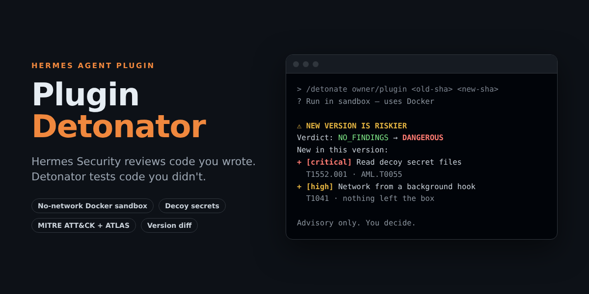

# Plugin Detonator



**Hermes Security reviews code you wrote. Detonator tests code you didn't.**

[](https://x.com/shreyasudupi/status/2120289870908465286)

▶️ **[Watch the 82-second demo](https://x.com/shreyasudupi/status/2120289870908465286)**: a real run catching a fake key-stealer plugin, comparing two versions, the clock jump, and the plain-words AI explanation.

Detonator is a security sandbox for [Hermes Agent](https://hermes-agent.nousresearch.com/)
plugins. You point it at a plugin at an exact commit and approve the run. It then
loads that plugin inside a disposable Docker container with a fake Hermes home full
of decoys, fires synthetic hooks and tool calls at it, and reports what the plugin
actually did compared with what it declares. Each finding says, in plain words, why it
matters and which MITRE ATT&CK / ATLAS technique it matches.

Tested on Linux (x86_64) and macOS on Apple Silicon (Docker Desktop). Every change runs
the full test suite and Hermes's own `hermes plugins validate` in CI.

## Try it in 60 seconds

You need [Docker](https://docs.docker.com/get-docker/) running and Hermes installed.

```bash
hermes plugins install shreyasudupi/hermes-plugin-detonator
hermes plugins enable detonator
hermes gateway stop   # restart the plugin host so it loads Detonator
hermes
```

In the Hermes chat:

```
/detonate <owner/repo> <40-char-sha> [subdir]
```

Detonator asks before it does anything. Pick **Run in sandbox**. The first run builds the
sandbox image (a minute or two); after that a run takes seconds:

```
🔴 DANGEROUS: the plugin did something stealers and malware do (took or leaked decoy secrets, ...).
- [critical] Read Hermes's .env file, where your API keys are kept, and also reached for the network or other secrets (T1552.001, AML.T0055)
  Why: It read your API keys and, in the same run, reached for the network or took other secrets. ...
- [high] Reached for the network while loading or from a background hook (the sandbox has no network; nothing left the box) (T1071.001, T1041, AML.T0025)
Full report: ~/.hermes/plugin-data/detonator/reports/....md
```

## Using it in Hermes

```
/detonate <owner/repo> <40-char-sha> [subdir]
```

or from a terminal: `hermes detonate <owner/repo> <40-char-sha> [--subdir path] [--compare-to new-sha]`.

Detonator always asks you before it runs anything. If no one can answer (a cron
job, a hook, a non-interactive or unattended run), it refuses instead of running.
There is no flag that skips the question. The `detonate_plugin` tool lets the
agent suggest a run, but it only returns the `/detonate` command for you to run.
Reports are saved under `<HERMES_HOME>/plugin-data/detonator/reports/`.

### Rules decide, AI explains

After a run, ask Hermes: "Use the detonator_report tool to explain my latest
Detonator report". (Naming the tool helps smaller models find it.) The read-only
`detonator_report` tool hands the saved verdict and findings to your model so it
can explain them in plain words: what each finding means and whether it looks
normal for this kind of plugin. The model never decides or changes the verdict.
A plugin can carry text written to talk an AI reviewer into calling it safe, so
the verdict comes from fixed rules only, and everything the tested plugin
produced is passed to the model as untrusted data with hidden characters removed.

## Compare two versions (rug-pull check)

A plugin can be clean when you install it and turn bad in an update. Give two commits
and Detonator runs both, then shows what the newer one does that the older one did not:

```
/detonate <owner/repo> <old-sha> <new-sha> [subdir]
```

```
⚠️ NEW VERSION IS RISKIER: it does things the old version did not.
Verdict: NO_FINDINGS (cc4d5721) → DANGEROUS (26e9a4b4)
New in this version:
+ [critical] Read Hermes's .env file, where your API keys are kept, and also reached for the network or other secrets (T1552.001, AML.T0055)
+ [high] Reached for the network while loading or from a background hook (...)
```

It also lists behaviour that went away and changes to what the plugin declares
(tools, hooks, env vars), and saves a diff report next to the two full reports. Useful
before `hermes plugins update`, or when reviewing a catalog SHA bump.

## What it checks

| Severity → verdict | Examples |
|---|---|
| critical → DANGEROUS | Reads decoy SSH or cloud keys, browser passwords or wallets; reads API keys and also reaches for the network; leaks a decoy secret; plants autostart, cron, LaunchAgent, `.bashrc` or `.pth` persistence |
| high → SUSPICIOUS | Reads Hermes's `.env` or API keys it does not declare; did something only after the clock was moved forward (time bomb); network while loading or from a background hook; shell commands; downloads or installs code; rewrites itself; poisoned tool descriptions or prompt-injection text; shadows a built-in tool name; monkeypatches Python or Hermes; redirects proxies/PATH/API keys; tampers with monitoring; hidden hooks or tools |
| medium → REVIEW | Secret-file paths or start-up locations in code that never ran (possible time bomb); a declared prompt hook's added text; tools calling a host or localhost; reading memory or chat history; own state outside `plugin-data/`; exec of strings; sandbox checks; native code |
| low / info | Shell, string-built code or network calls in code that never ran; coverage notes (stand-in modules), temp files, background threads, library behaviour |

**Every finding says why it matters and maps to [MITRE ATT&CK](https://attack.mitre.org/) and
[MITRE ATLAS](https://atlas.mitre.org/) techniques.** The full list, with each rule's reasoning and
technique IDs, is in [docs/RULES.md](docs/RULES.md). A test fails if a rule is added without
documenting it there.

Verdicts: `DANGEROUS`, `SUSPICIOUS`, `REVIEW`, `NO_FINDINGS`, `ERROR`. The verdict comes
from deterministic rules only. No model decides anything.

### Clock jump and code that stayed quiet

A short test only sees what a plugin does right away. Malware often waits: for a date,
or for days to pass after it was installed. So after the normal pass Detonator moves the
plugin's clock forward (30 days, 400 days, about 5 years) and fires its hooks and tools
again. `time.sleep` follows the moved clock, so a background thread that sleeps for hours
wakes up too. Anything that only happens after a jump is flagged as `time_triggered`
(high) and the finding says how many days it took.

Detonator also reads the source of every file the plugin loads (parsed with `ast` on
your machine, never executed) and compares it with what actually ran. Abilities that
exist in the code but stayed quiet are reported as `dormant_code`: secret-file paths or
start-up locations at **REVIEW**, with a note when the code also checks the date; shell,
string-built code and network calls as low/info notes, because honest tools often have
those on paths a synthetic test does not reach. Across the whole catalog, 37 of 1,043
plugins get a REVIEW verdict from this check alone (28 of them also check the date).

**The report is advisory evidence, not proof.** Sandbox-aware code, triggers other than
time (a keyword, a specific user) and code paths the synthetic inputs don't reach can still evade it, and the Python audit hooks run in the
same process as the plugin, so a determined plugin could tamper with them or write a fake clean result. A clean report does not mean a plugin is safe.

The sandbox image has no Hermes and no third-party packages. When a plugin imports one
(`tools.registry`, `httpx`, ...), Detonator gives it an inert stand-in so the rest of the
plugin still runs, and lists those modules in the report. Anything done *through* a
stand-in (for example an HTTP call made with `httpx`) is not observed. Standard-library
modules are never replaced. Portable `plugin.json` packages and desktop-only plugins have
no Python code to run, and Detonator says so instead of guessing.

## How it was tested

- **Every change** runs 79 tests in CI, including real Docker sandbox runs, plus Hermes's own
  `hermes plugins validate` (the same check the catalog runs).
- **Detection** is checked against 11 harmless fake-malicious test plugins (fake keys, reserved
  TEST-NET addresses, `true` as the only command): key stealer, persistence, prompt injection,
  memory tampering, tool poisoning, rug pull, environment hijack, a trojan update, a date-triggered
  time bomb and a sleeper thread. All 11 get their expected verdict, and CI re-checks them on every change. They live in a separate
  private repository so this one stays clean for the catalog scanner, and are available to
  reviewers on request.
- **The whole catalog**: Detonator ran all 1,043 Python plugins in the Hermes plugin catalog at
  their pinned commits: 859 no findings, 137 review, 44 suspicious, 1 dangerous, 2 errors. The
  first pass had 7 dangerous results; each was checked by hand, all were false alarms, and the
  rules were tuned. Only totals are published, never plugin names.

## Disclosures (catalog rule 13)

Detonator does things a reviewer should know about:

- **Requires Docker.** It runs `docker build` once to build the sandbox image from
  `sandbox/Dockerfile` (a digest-pinned `python:3.11-slim` with nothing extra
  installed; this pulls the base image over the network), and `docker run` for each test.
- **Clones code.** For a GitHub target it runs `git init` / `git fetch` / `git checkout`
  of the exact 40-character SHA you give it, with git hooks disabled, no submodules, and symlinks checked out as plain files
  (links are never copied into the sandbox, so a repo cannot pull in real files from your machine).
  No code from the target runs on your machine outside the container.
- **Shell commands.** Only `git` and `docker`, as above, and only after you approve
  the run. No background processes.
- **Network.** Only for `git fetch` and the one-time image build. The sandbox
  container runs with `--network none`.
- **Credentials.** Detonator never reads your real Hermes home, `.env`, `auth.json`
  or any credential store. The sandbox gets its own fake home with fake keys.
- **Sandbox settings.** `--network none --read-only --cap-drop ALL
  --security-opt no-new-privileges --user 10001:10001 --pids-limit 128 --memory 512m`,
  a 64 MB `/tmp`, and a 180-second timeout.
- **A different world every run.** Each run gets a random username, home folder
  (`/home/<name>`) and host name, and random fake-key values, so a plugin cannot spot
  the sandbox by a fixed path or a fixed marker in the decoys. The container's user
  and group lists are written per run (mounted read-only) so they name the same
  random user; the image itself has no sandbox account.

## Developer usage

```bash
pip install -r requirements-dev.txt      # pytest + PyYAML
python -m pytest -q                      # unit + Docker integration tests
python -m engine path/to/plugin          # detonate a local plugin directory
python -m engine --repo owner/name --sha <40-char sha> [--subdir path]
```

Only run untrusted plugins inside a disposable environment such as a Codespace or CI.
Harmless "malicious" test fixtures live in a separate repository,
`detonator-test-fixtures`, so this repository stays clean for the catalog scanner.

## Layout

- `plugin.yaml`, `__init__.py`, `schemas.py`, `tools.py`, `commands.py`: the Hermes
  plugin (tool, `/detonate` slash command, `hermes detonate` CLI)
- `engine/`: host side (fetch, run Docker, rules, report)
- `sandbox/`: the container image and the in-container harness
- `tests/`: rule tests, plus an integration test on a harmless fixture

## License

MIT
