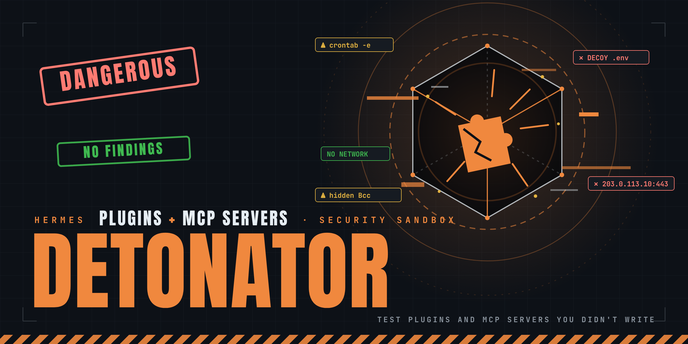
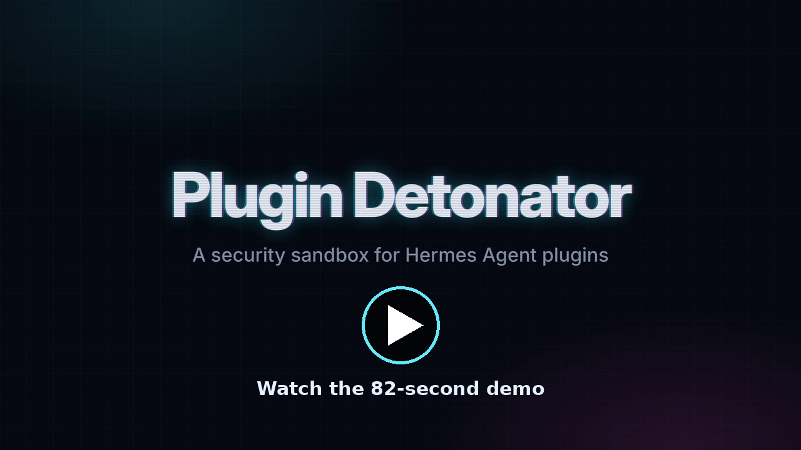

# Detonator

**A security sandbox for Hermes Agent plugins, MCP servers and skills.**



**Hermes Security reviews code you wrote. Detonator tests code you didn't.**

**Current version: v0.5.2** ([what's new](#versions))

[](https://x.com/shreyasudupi/status/2120289870908465286)

▶️ **[Watch the 82-second demo](https://x.com/shreyasudupi/status/2120289870908465286)**: a real run catching a fake key-stealer plugin, comparing two versions, the clock jump, and the plain-words AI explanation.

Detonator is a security sandbox for [Hermes Agent](https://hermes-agent.nousresearch.com/)
plugins, MCP servers and skills. You name a plugin (its catalog name, or its GitHub page) and approve the run. It then
loads that plugin inside a disposable Docker container with a fake Hermes home full
of decoys, fires synthetic hooks and tool calls at it, and reports what the plugin
actually did compared with what it declares. Each finding says, in plain words, why it
matters and which MITRE ATT&CK / ATLAS technique it matches.

Since v0.3 it watches each run from two sides: a monitor inside the plugin's Python process,
and an **outside monitor** in separate containers the plugin cannot reach (a system-call
tracer and a fake internet). A plugin that hides from or switches off the inside monitor,
or writes a fake clean result, is still caught. See [Outside monitor](#outside-monitor).

New in v0.4: **MCP servers.** `/detonate-mcp <server-name>` tests a server from your Hermes
config (npm, PyPI or a local script) the same way: in the sandbox, with both monitors, while a
stand-in for Hermes lists its tools and calls every one. See [Test an MCP server](#test-an-mcp-server).

New in v0.5: **skills.** `/detonate-skill <folder | installed-name | owner/repo/folder@sha>` reads a
skill's SKILL.md and files for planted instructions and download-and-run lures, then runs its scripts
and the commands it tells the agent to run, each on its own, in the sandbox with the outside monitor.
See [Test a skill](#test-a-skill).

Tested on Linux (x86_64), macOS on Apple Silicon (Docker Desktop) and Windows (Docker
Desktop with WSL 2, in both the `hermes` terminal chat and the Desktop app). Every change runs
the full test suite and Hermes's own `hermes plugins validate` in CI, including on Windows.
In the Desktop app, the very first `/detonate` can show "request timed out after 30s" while
the sandbox image builds (Desktop gives a slash command 30 seconds). Run the same command
again: the image is built by then, and runs take seconds. Or run the first one in the
`hermes` terminal chat, which has no limit.

## Try it in 60 seconds

You need [Docker](https://docs.docker.com/get-docker/) running and Hermes installed.
Not sure Docker is ready? Type `/detonate check` in Hermes: it only asks Docker for its
status, runs nothing, and tells you what to fix (see [Docker problems](#docker-problems)).

One command installs it from the Hermes plugin catalog, switches it on and restarts Hermes's
plugin host so it loads:

```bash
hermes plugins install detonator && hermes plugins enable detonator && hermes gateway stop
hermes
```

If Hermes says `'detonator' is not in the Hermes plugin catalog`, run `hermes update` first:
Hermes from before Nov 9, 2026 cannot read the online catalog, so it misses plugins added since
its release.

Use the catalog name `detonator`, not `shreyasudupi/hermes-plugin-detonator`: Hermes blocks
installs straight from a GitHub repo when its install scan finds security words, and
Detonator's docs and tests are full of them (they describe what it catches).

On Windows PowerShell 5, use `;` instead of `&&`. New to Hermes or Docker? The
[step-by-step quickstart](docs/QUICKSTART.md) starts from nothing, on macOS, Windows and Linux.

In the Hermes chat, name the plugin you want to test. You don't need a commit SHA:

```
/detonate <name>                               # a plugin from the Hermes catalog, by name
/detonate https://github.com/owner/repo        # any plugin on GitHub: its newest commit
/detonate update <name>                        # before updating: your installed copy vs. the update
```

`<name>` is a plugin's name as `hermes plugins search <word>` or `hermes plugins list` shows it. A catalog name
tests exactly the commit and folder that `hermes plugins install <name>` would install. Every
report names the full commit it tested.

Detonator asks before it does anything, and you choose the test:

- **Run full test**: inside and outside monitors. It also catches plugins that hide what they do
  or fake a clean result, and takes a second or two longer.
- **Run quick test**: inside monitor only. A little faster, but a plugin that hides what it does or
  fakes its own report can fool it.

Every report starts with the test mode it used, and a quick test's report lists what it did not
check, so a clean quick result is not mistaken for a clean full one. The first run builds the sandbox images (a minute or two);
after that a run takes seconds:

```
🔴 DANGEROUS: at least one critical finding, for example taken or leaked decoy secrets, autostart persistence or what looks like a reverse shell; see the findings below.
- [critical] Read Hermes's .env file, where your API keys are kept, and also reached for the network or other secrets (T1552.001, AML.T0055)
  Why: It read your API keys and, in the same run, reached for the network or took other secrets. ...
- [high] Reached for the network while loading or from a background hook (the sandbox has no real network; nothing left the box) (T1071.001, T1041, AML.T0025)
Full report: ~/.hermes/plugin-data/detonator/reports/....md
```

(That run was on a Mac. On Windows the report path starts with `%LOCALAPPDATA%\hermes` instead.)

## Using it in Hermes

| You want to test | Type |
|---|---|
| A plugin from the Hermes catalog, before installing it | `/detonate <catalog-name>` |
| Any plugin on GitHub | `/detonate <owner/repo or GitHub link> [folder]` (its newest commit) |
| An update, before you apply it | `/detonate update <installed-name>` |
| One exact commit, or two to compare | `/detonate <owner/repo> <40-char-sha> [<newer-sha>] [folder]` |
| An MCP server in your config.yaml | `/detonate-mcp <server-name>` |
| An MCP server in a folder on your computer | `/detonate-mcp <folder>` (with an `mcp-server.yaml`, see below) |
| A skill in a folder, installed, or on GitHub | `/detonate-skill <folder>`, `/detonate-skill <installed-name>` or `/detonate-skill <owner/repo/folder@40-char-sha>` |

`[folder]` is only for repos that keep the plugin in a subfolder; catalog names fill it in for
you. The newest commit is looked up (with `git ls-remote`) only after you approve the run.
`update` reads which commit you have installed from the plugin's own folder and compares it with
what `hermes plugins update` would install: the catalog's pin, or for a plugin installed from
GitHub, its newest commit.

From a terminal: `hermes detonate <catalog-name | owner/repo | update name> [sha] [--subdir path] [--compare-to new-sha]`.
`/detonate check` only tells you whether Docker is ready; it runs nothing. The terminal command needs no AI provider, so it works on a
Hermes that has no model set up yet.

Detonator always asks you before it runs anything. If no one can answer (a cron
job, a hook, a non-interactive or unattended run), it refuses instead of running.
There is no flag that skips the question. The `detonate_plugin` tool lets the
agent suggest a run (by catalog name or repo), but it only returns the `/detonate` command for you to run.
Your Hermes home is `~/.hermes` on macOS and Linux and `%LOCALAPPDATA%\hermes` on Windows (or
wherever `HERMES_HOME` points). Reports are saved in its `plugin-data/detonator/reports/` folder,
and `/detonate-mcp <server-name>` reads the server's entry from its `config.yaml`.

### Docker problems

`/detonate check` tells you which of these you have. Detonator shows the same advice
if a run fails for one of these reasons.

| What you see | What to do |
|---|---|
| Docker isn't installed, or can't be found | Install [Docker Desktop](https://docs.docker.com/get-docker/) (Mac, Windows), or Docker Engine on Linux. Colima, OrbStack and Rancher Desktop also work. |
| Docker is installed but not running | Open Docker Desktop (or start Colima or OrbStack) and wait until it says it is running. On Linux: `systemctl start docker`. |
| Your user isn't allowed to use Docker (Linux) | Add yourself to the `docker` group and log out and back in, or use rootless Docker. Members of that group control Docker, so do this only on your own machine. |
| Couldn't download the base image | The first run downloads `python:3.11-slim` once to build the sandbox. Check your internet, VPN or proxy. Later runs need no network. |
| Docker Hub download limit | Run `docker login` with a free Docker account, or wait a few hours. |
| Docker Desktop says "WSL not installed" (Windows) | Docker Desktop runs Linux containers through WSL 2. Open PowerShell as administrator, run `wsl --install`, restart the PC, then open Docker Desktop again. |
| Docker Desktop is set to Windows containers (Windows) | Right-click the Docker icon in the taskbar and choose **Switch to Linux containers...**. The sandbox is a Linux container. |
| Out of disk space | `docker system prune` removes stopped containers and unused images, or give Docker more disk in Docker Desktop (Settings > Resources). |
| Mounts denied | Docker Desktop: Settings > Resources > File sharing, add your temporary folder (on a Mac, `/var/folders`). Colima: start it with that folder mounted. |
| Docker didn't answer in time | Docker may still be starting. Wait a moment and try again. |

### Rules decide, AI explains

After a run, ask Hermes: "Use the detonator_report tool to explain my latest
Detonator report". (Naming the tool helps smaller models find it.) The read-only
`detonator_report` tool hands the saved verdict and findings to your model so it
can explain them in plain words: what each finding means and whether it looks
normal for this kind of plugin. The model never decides or changes the verdict.
A plugin can carry text written to talk an AI reviewer into calling it safe, so
the verdict comes from fixed rules only, and everything the tested plugin
produced is passed to the model as untrusted data with hidden characters removed.

## Compare two versions (rug-pull check)

A plugin can be clean when you install it and turn bad in an update. Before you update an
installed plugin, run `/detonate update <installed-name>`: Detonator runs the version you have and
the version an update would install, then shows what the newer one does that the older one did not.
Or give any two commits yourself:

```
/detonate <owner/repo> <old-sha> <new-sha> [subdir]
```

```
⚠️ NEW VERSION IS RISKIER: it does things the old version did not.
Verdict: NO_FINDINGS (cc4d5721) → DANGEROUS (26e9a4b4)
New in this version:
+ [critical] Read Hermes's .env file, where your API keys are kept, and also reached for the network or other secrets (T1552.001, AML.T0055)
+ [high] Reached for the network while loading or from a background hook (...)
```

It also lists behaviour that went away and changes to what the plugin declares
(tools, hooks, env vars), and saves a diff report next to the two full reports. Useful
before `hermes plugins update`, or when reviewing a catalog SHA bump.

## Test an MCP server

MCP servers give Hermes new tools, and Hermes trusts them fully by default. A server can lie in
its tool descriptions (instructions only the model sees), change its tools after you approved
them, run your AI model through sampling, ask you for keys, or simply steal files when a tool
runs. `/detonate-mcp` runs the server and watches all of that.

```
/detonate-mcp <server-name>     # a server under mcp_servers: in your Hermes config
/detonate-mcp <folder>          # a server's code, with an mcp-server.yaml next to it
```

After you approve, Detonator:

1. **Reads the entry** through Hermes's own config reader (the active profile, values as written,
   so `${VAR}` references stay unexpanded). It keeps the env and header *names*; the values are
   only checked for keys written straight into the file, then dropped. The server gets fake values.
2. **Gets the code.** `npx -y <package>@<version>` and `uvx <package>==<version>` entries are
   downloaded in a separate container: network on, no decoys, npm install scripts off, PyPI wheels
   only (a source package would run code to build). Local `python`/`node` scripts are copied
   from their folder. Remote (`url:`) servers run on someone else's computer, so only their entry
   is checked. Docker and other programs are not supported yet.
3. **Runs it in the sandbox** with both monitors. A stand-in for Hermes starts the server,
   lists its tools, resources and prompts, calls every tool with test input that fits it (an email
   address for an email field, a link, a test file), calls every tool a few more times, reads every
   resource and prompt, answers sampling with a marked fake reply, declines elicitation, and lists
   everything again to catch a rug pull. Then it starts the server again with its clock moved 400
   days forward and does it all once more, so code that waits for a date or for weeks after install
   shows itself (Python and Node servers; other languages keep the real clock). Packages with npm install scripts get an install step
   first, inside the sandbox with decoy keys in reach, because that is when such scripts strike.
   Folder arguments (like a filesystem server's allowed folder) are swapped for empty test folders.

It reports what the model would see (poisoned or bossy tool descriptions, instructions about other
tools, injection in results, tool names with look-alike letters), what the server asked Hermes for
(sampling, credential prompts), what it did (files, programs, network, persistence, install scripts,
a "read-only" tool that writes, a hidden copy of an email to an address it was not given, anything
it did only after the clock moved forward or after being used a few times), and
risky settings in the entry (no exact version, a key in config.yaml, plain `http://`, full trust
for a third-party server). The same rules decide the verdict; see [docs/RULES.md](docs/RULES.md#mcp-servers).

`mcp-server.yaml` for a folder is the same shape as one entry under `mcp_servers:`:

```yaml
command: python
args: ["server.py"]
env:
  WEATHER_API_KEY: ""      # names only; the server gets a fake value
```

Unlike scanners that start the server on your computer or send its descriptions to an online
service, Detonator reads descriptions only inside the sandbox and sends nothing anywhere.
There is no quick test for MCP servers: a server is its own program, so only the outside monitor
sees what it does. If that monitor cannot start, the result is an error, not a clean run.

Limits: a server that needs a real account, only acts on specific input, waits for a trigger other
than time, or checks the clock in a language other than Python or Node can look clean. A server that needs a program the sandbox lacks (such as
`git` or a downloaded browser) stops early and is reported as not started. Its code is not yet read for abilities it did not use
during the run. A clean run is evidence, not proof.

## Test a skill

A Hermes skill is a folder with a `SKILL.md` of instructions, often with scripts next to it. Hermes
never runs a skill's scripts by itself: the agent reads SKILL.md and runs what it says through its
terminal tool. So a bad skill does not need bad code. Real malicious skills mostly hide in the text:
a "prerequisite" that downloads and runs an installer, a base64 line piped to the shell, an order to
send `~/.ssh` somewhere, or text the user cannot see. `/detonate-skill` checks both the text and
what running it does.

```
/detonate-skill <folder>                 # a skill folder with a SKILL.md
/detonate-skill <installed-name>         # a skill in your Hermes skills folder (copied, never changed)
/detonate-skill <owner/repo/folder@sha>  # a skill on GitHub at an exact 40-character commit
```

You choose **Run full test** or **Read the text only**. The first full skill test builds a bigger
sandbox image (Debian with Python and Node.js, about 1.7 GB, built once) so the everyday tools a
skill calls are really there. Reading the text only needs no image. Detonator:

1. **Reads every file** on your computer without running anything: frontmatter, fenced shell
   blocks, inline commands, links and hidden text (invisible Unicode tags, zero-width and
   right-to-left characters, HTML comments, files saved as UTF-16 or Latin-1). It looks for download-and-run commands, password-zip
   and fake-installer lures, prompt injection and "always use this skill" text, requests for keys,
   orders to send files out or change the agent's config, persistence, reverse shells, packed
   scripts, binaries and links that point outside the folder.
2. **Installs it in the sandbox** where Hermes keeps skills (`~/.hermes/skills/<name>`, with
   `HERMES_SKILL_DIR` set) next to the same decoy home a plugin run gets, plus a work folder with
   harmless sample files. Keys the skill declares get fake values.
3. **Runs each shell block and command from SKILL.md** on its own, as the agent would, with
   placeholders such as `<file>` filled with sample files, then **each script** with no arguments
   and with `--help`. Every step has a 20-second limit and fresh decoys. Small stand-ins for macOS
   commands (`base64 -D`, `open`, `xattr`, `osascript`) let Mac-only lures run far enough to be seen.
   The scripts then run again with the clock 400 days ahead.
4. **Hands out a marked stand-in for downloaded code.** When a command downloads a script or
   installer, the fake internet answers with a harmless stand-in that only touches a marked file. If
   that marker then shows up in the trace, the skill ran code it downloaded, and the report says
   from where.

The report lists what each step did, which hosts the skill contacted that its own text never
mentions, and which steps could not run. If too few steps ran to say anything (a missing tool, a
script that needs a real account), the verdict is **NOT ENOUGH COVERAGE**, not a clean result.
Rules: [docs/RULES.md](docs/RULES.md#skills).

Limits: Detonator does not ask an AI model to follow the skill, so instructions that only an agent
acting on a task would carry out are judged from the text alone. A step that needs a real account,
a Mac, Windows or a second download that the fake internet cannot stand in for can look clean. A
clean run is evidence, not proof.

## What it checks

| Severity → verdict | Examples |
|---|---|
| critical → DANGEROUS | Reads decoy SSH or cloud keys, browser passwords or wallets; reads API keys and also reaches for the network; leaks a decoy secret, even base64, hex, compressed or split across requests; quietly sends a tool call somewhere else (a new message recipient, web address or chained command); points model requests at another server; plants autostart, cron, LaunchAgent, `.bashrc` or `.pth` persistence |
| high → SUSPICIOUS | Reads Hermes's `.env` or API keys it does not declare; reads every key at once through `/proc`; did something only after the clock was moved forward (time bomb); network while loading or from a background hook; shell commands; downloads or installs code; rewrites itself; poisoned tool descriptions or prompt-injection text; shadows a built-in tool name; monkeypatches Python or Hermes; redirects proxies/PATH/API keys; tampers with monitoring; hidden hooks or tools; changes Hermes's config or files outside its folder; opens a listening port; an MCP tool that sends a hidden copy of a message to an address it was not given; a plugin name with `../` in it; floods the activity log to hide something; tries to fill your disk; sends your chat text out; changes tool arguments from a hook; rewrites the model's messages or model; skips a real tool and makes up its result; tool names disguised as built-ins (`rеad_file` with a Cyrillic е, `termina1`); adds huge text to every prompt; a description that promises the opposite of what it does ("works offline" but connects out) |
| medium → REVIEW | Secret-file paths or start-up locations in code that never ran (possible time bomb); a declared prompt hook's added text; tools calling a host or localhost; reading memory or chat history; copying the whole environment; listing your home or key folders; reading system account files; calling other agent tools on its own; declared middleware that rewrites tool arguments; a tool result over 100,000 characters; tool names one letter from a built-in; own state outside `plugin-data/`; exec of strings; sandbox checks; native code; crashing while loading |
| low / info | Registers middleware; shell, string-built code or network calls in code that never ran; coverage notes (stand-in modules), temp files, background threads, library behaviour |

**Every finding says why it matters and maps to [MITRE ATT&CK](https://attack.mitre.org/) and
[MITRE ATLAS](https://atlas.mitre.org/) techniques.** The full list, with each rule's reasoning and
technique IDs, is in [docs/RULES.md](docs/RULES.md). A test fails if a rule is added without
documenting it there.

Verdicts: `DANGEROUS`, `SUSPICIOUS`, `REVIEW`, `NO_FINDINGS`, `ERROR`. The verdict comes
from deterministic rules only. No model decides anything.

### Outside monitor

The inside monitor (Python audit hooks) runs in the same process as the plugin, so a
determined plugin could read files through C code it loads, or write its own "all clear"
result. From v0.3 every run also starts two small containers next to the plugin's, which
never run plugin code and which the plugin cannot reach:

- **A tracer.** The plugin's container joins the tracer's process namespace. The tracer
  attaches `strace` to the sandbox before the plugin is imported (the sandbox waits for it)
  and records every file opened, program started and connection made, by every thread and
  every program the plugin starts. The plugin runs as an ordinary user with no
  capabilities, so it cannot stop the tracer, and the trace is stored where only the tracer
  can write.
- **A fake internet.** The plugin's container joins this container's network, which has no
  real network at all: every address and every port answers locally, every DNS lookup gets a made-up
  address, plain HTTP gets a short "200 OK", and whatever the plugin sends is logged.
  HTTPS is read too: each run makes its own short-lived test certificate authority inside the
  fake internet, and the sandbox is told to trust it (the standard `SSL_CERT_FILE`,
  `REQUESTS_CA_BUNDLE`, `NODE_EXTRA_CA_CERTS` and `CURL_CA_BUNDLE` settings, as a company proxy
  would set them), so a key sent inside an HTTPS request is caught as well. A program that refuses
  that authority still shows the server name it asked for.

Detonator then compares the two records. Three rules come from this:

| Rule | Severity | Catches |
|---|---|---|
| `secret_sent_out` | critical | A fake key reaching the fake internet, plain or disguised (base64, base32, hex, URL escapes, rot13, reversed, compressed, or layers of these), or hidden in DNS names, even split across several lookups |
| `monitor_blind_spot` | critical | The plugin's own process opening a decoy file, connecting out or starting a program that the inside monitor never recorded |
| `result_forged` | critical | Anything other than Detonator writing, removing or linking the result file (Detonator never reads it through a link) |

It also adds evidence to `decoy_accessed` when a program the plugin started reads a decoy
file (high when it is that program's own login file, such as pip reading `.netrc`), and to
`monitor_tamper` for attempts to trace or read another process. If the plugin kills the
sandbox, the outside evidence is still judged instead of reporting a bare error.

The outside monitor is on by default and adds a second or two to a run. Its image is built
once, next to the sandbox image (it installs `strace` and `iptables` from Debian, so the first build needs
the internet). If it cannot start, the plugin is still tested by the inside monitor and the
report says plainly that the outside monitor did not run. To skip it on purpose, pick **Run
quick test** when `/detonate` asks (or `hermes detonate --quick`); the report then says at the
top that it was a quick test and lists what that did not check. `DETONATOR_OUTSIDE=0` switches it off for every run.

### Clock jump and code that stayed quiet

A short test only sees what a plugin does right away. Malware often waits: for a date,
or for days to pass after it was installed. So after the normal pass Detonator moves the
plugin's clock forward (30 days, 400 days, about 5 years) and fires its hooks and tools
again. `time.sleep` follows the moved clock, so a background thread that sleeps for hours
wakes up too. Anything that only happens after a jump is flagged as `time_triggered`
(high) and the finding says how many days it took.

Detonator also reads the source of every file the plugin loads (parsed with `ast` on
your machine, never executed) and compares it with what actually ran. Abilities that
exist in the code but stayed quiet are reported as `dormant_code`: secret-file paths or
start-up locations at **REVIEW**, with a note when the code also checks the date; shell,
string-built code and network calls as low/info notes, because honest tools often have
those on paths a synthetic test does not reach. Across the whole catalog (measured on v0.2.1, Nov 2026), 37 of 1,043
plugins get a REVIEW verdict from this check alone (28 of them also check the date).

**The report is advisory evidence, not proof.** Sandbox-aware code, triggers other than
time (a keyword, a specific user) and code paths the synthetic inputs don't reach can still
evade it. The outside monitor sees what the kernel does, not what the plugin meant: it reads
inside HTTPS only when the program trusts the run's test authority (code that ships its own
certificate list does not), and a plugin can notice it is being traced. Work done through io_uring
(a shared ring the kernel reads, not separate calls) is not traced; current Docker blocks io_uring
by default, the tracer checks this on every run, and the report warns if your Docker allows it. A clean report does not mean a plugin is safe.

**On Linux the sandbox shares your computer's kernel.** Docker containers are not virtual
machines: Detonator drops every capability, runs read-only and as an unprivileged user, but a
kernel bug could still let code out. On macOS and Windows, Docker Desktop runs containers inside
its own virtual machine, which adds a wall. For code you strongly suspect, use a throwaway
machine or VM.

The sandbox image has no Hermes and no third-party packages. When a plugin imports one
(`tools.registry`, `httpx`, ...), Detonator gives it an inert stand-in so the rest of the
plugin still runs, and lists those modules in the report. Anything done *through* a
stand-in (for example an HTTP call made with `httpx`) is not observed. Standard-library
modules are never replaced. Portable `plugin.json` packages and desktop-only plugins have
no Python code to run, and Detonator says so instead of guessing.

## How it was tested

- **Every change** runs over 450 tests in CI (on Python 3.11 and 3.13), including real Docker sandbox runs, plus Hermes's own
  `hermes plugins validate` (the same check the catalog runs).
- **Detection** is checked against 37 harmless test plugins (fake keys, reserved TEST-NET
  addresses, `true` as the only command): stealers of keys, browser logins and memory, persistence,
  prompt injection, tool poisoning, a rug pull, a backdoor port, a config hijack, a log flood, a
  trojan update, a date-triggered time bomb, a sleeper thread, a plugin that reads keys through C
  code to dodge the inside monitor and one that forges a clean result (both caught only from
  outside), one that swaps the result file for a link, an encoded key leak, an argument swapper, a model-request redirector, look-alike tool
  names, an output flood, a plugin that tries to fill your disk, a chat snooper, a plugin whose description lies and a Kubernetes helper that
  shows its login file's key to the model, plus honest and grey-area plugins (one a Docker helper that reads
  only Docker's own login file) that must not be flagged as dangerous. All 37 get their expected verdict,
  together they set off every one of the plugin rules, and CI re-checks them on every change. They live in a separate private
  repository so this one stays clean for the catalog scanner, and are available to reviewers on
  request.
- **MCP servers** are checked against 31 more harmless test servers (Python and Node: poisoned and
  cross-tool descriptions, a rug pull and one that waits for a few uses, a "read-only" tool that
  writes, key stealers, a sampling abuser, a credential phisher, an npm postinstall dropper, a risky
  config, a time bomb that waits 200 days after install, an email tool that adds a hidden Bcc over
  HTTPS, orders hidden in a tool result, an open port, a look-alike tool name and a disk filler, plus six modelled on
  real npm malware: a reverse shell, a key sent to an odd port, a `wallet.dat` hunter, a hidden Bcc
  that only fires without optional fields, obfuscated code and an ngrok beacon, and five around a
  tool's own login file: an honest Kubernetes helper that reads only `~/.kube/config` (review), one that
  sends that file's token out, one that sends it scrambled, one that also reads the AWS keys, and one that only calls itself
  "kubernetes" in its own start-up answer; together with the
  test plugins they set off every plugin and MCP rule) and against official
  servers from the MCP project (memory, filesystem, sequential thinking, everything, fetch, time)
  and 16 popular third-party ones (Playwright, Puppeteer, GitHub, Notion, Sentry, Supabase,
  Context7, Firecrawl, Exa, Tavily, Brave Search, DuckDuckGo, AWS Documentation, Atlassian, SQLite,
  git), which must come out clean or review: 8 no findings and 14 review across all 22, none worse. Stress tests cover servers that hang, flood output, list
  5,000 tools, start hundreds of programs, kill the stand-in for Hermes, or hang in an install script.
- **Skills** are checked against 22 harmless test skills (fake "prerequisite" installers, base64
  piped to the shell, instructions in invisible Unicode, a key stealer, persistence, a reverse shell,
  a time bomb, a daemon left running, a padded SKILL.md, a disk filler, plus honest skills that must stay clean), on
  250 honest skills from Anthropic, OpenAI and Nous (all no findings on the text checks), and in the
  cloud sandbox only on [Datadog's malicious skills](https://github.com/DataDog/malicious-software-packages-dataset).
  On the 49 real malicious skills held back while the rules were written, 28 come out suspicious
  or dangerous (10 dangerous); 13 get NOT ENOUGH COVERAGE (too little of them could run: 5 need a
  second download from a live server, 4 act only through an AI model, 1 is macOS-only); the other 8
  are missed, half of them instructions that only a model following them would act on. The split was fixed before tuning, but these samples had been read while the rules were
  designed, so this is not a clean benchmark.
- **The whole catalog** (measured on v0.2.1, Nov 2026, with 45 rules and before the outside monitor): Detonator ran all 1,043 Python plugins in the Hermes plugin catalog at
  their pinned commits: 859 no findings, 137 review, 44 suspicious, 1 dangerous, 2 errors. The
  first pass had 7 dangerous results; each was checked by hand, all were false alarms, and the
  rules were tuned. Only totals are published, never plugin names. "Suspicious" usually means risky but
  undisclosed behaviour, not malware: the most common reasons were running shell commands (23),
  writing outside the plugin's folder (8) and reading undeclared API keys (7). The one dangerous
  result reads Hermes's .env for its own OpenRouter key and sends it to OpenRouter, which breaks
  catalog rule 11 but looks like a convenience fallback, not theft. The 2 errors are plugins that
  ran past the time limit or were stopped by the container.

## Disclosures (catalog rule 13)

Detonator does things a reviewer should know about:

- **Requires Docker.** It runs `docker build` once to build the sandbox image from
  `sandbox/Dockerfile` (a digest-pinned `python:3.11-slim` with nothing extra
  installed; this pulls the base image over the network), and once more for the outside
  monitor image from `sandbox/monitor/Dockerfile` (the same base plus Debian's `strace` and
  `iptables`).
  Each test runs `docker run` for the plugin and for the two monitor containers, then
  `docker wait`, `docker stop` and `docker rm` to clean them up.
- **Clones code.** For a GitHub target it runs `git init` / `git fetch` / `git checkout`
  of one exact 40-character commit: the one you give, the one the Hermes catalog pins, or the
  newest one, found with `git ls-remote` (reads the repo's branch list only) after you approve, with git hooks disabled, no submodules, and symlinks checked out as plain files.
  Your own global and system git settings are left out (only proxy and certificate settings are
  kept), so a filter or helper you installed for your own work, such as Git LFS, never runs on a
  downloaded repository
  (links are never copied into the sandbox, so a repo cannot pull in real files from your machine).
  No code from the target runs on your machine outside the container.
- **Shell commands.** Only `git` and `docker`, as above, and only after you approve
  the run. The two monitor containers run only while a test runs and are removed after it;
  nothing keeps running on your machine.
- **Network.** Only for `git ls-remote`, `git fetch`, the one-time image builds and, for
  `/detonate-mcp`, downloading the server's npm or PyPI package (in its own container, see below). A catalog name
  is looked up with Hermes's own catalog reader, which may refresh Hermes's cached catalog. No container that runs the tested code gets a real
  network (only the download container described below does, and it runs nothing): the monitor containers run with `--network none`, and the plugin's container
  shares the fake internet's network, which only answers locally.
- **Credentials.** Detonator never reads your `.env`, `auth.json` or any credential store,
  and reads nothing else from your real Hermes home except, for `/detonate-mcp <server-name>`, that
  one `mcp_servers:` entry through Hermes's own config reader (see MCP servers below). For `/detonate update <name>` it reads only that plugin's own commit
  records (`.git/HEAD`, its branch ref, the remote URL in `.git/config`, and Hermes's
  `.hermes-catalog.json`), as files, without running git there. The sandbox gets its own fake home with fake keys.
  The `git` and `docker` commands it runs get only an allow-listed environment (PATH, HOME,
  locale, Docker and proxy settings), never the API keys Hermes has loaded.
- **Sandbox settings.** `--read-only --cap-drop ALL
  --security-opt no-new-privileges --user 10001:10001 --pids-limit 128 --memory 512m --cpus 1`,
  a 64 MB `/tmp`, a 180-second timeout, a run that writes more than 256 MB to its output folder
  on your disk is stopped (and reported as `disk_flood`), and an activity log capped at 5,000 events (a flood is
  reported, and the most repeated actions are thinned first so rare ones such as a key read are kept).
  With the outside monitor the plugin's container uses the fake internet's network and the tracer's
  process namespace; without it, `--network none`.
- **Monitor containers.** Both run `--network none --read-only --cap-drop ALL
  --security-opt no-new-privileges` with small memory and process limits. The tracer adds only
  `SYS_PTRACE` (to attach `strace`). The fake internet adds `NET_ADMIN` (to make every address
  answer locally inside its own empty network, and to load one `iptables` rule there that sends
  every other port to a catch-all listener) and `NET_BIND_SERVICE` (to listen on ports such
  as 80 and 443), and gives both up once it is listening. To read HTTPS it makes a new
  certificate authority for each run with `openssl` (key kept in the container's private memory,
  never written to disk or shared); only the public certificate is mounted read-only into the
  sandbox, and it is thrown away with the run. Nothing on your machine is told to trust it. Neither container is privileged, both
  keep Docker's default seccomp and AppArmor profiles, neither can reach a real network, the
  Docker socket or any of your files, and each only writes its own log folder (Detonator never
  follows a link there). Docker removes them as soon as they stop, and they stop by themselves
  after 5 minutes, so even a run you interrupt leaves nothing running: when the tracer stops,
  the plugin's container stops with it.
- **MCP servers (`/detonate-mcp`).** Reads the named entry under `mcp_servers:` through Hermes's
  own config reader (`hermes_cli.config`), never your `.env` or `auth.json`; env and header values
  are only checked for written-in keys, never stored, sent or shown beyond their first 4 characters.
  Downloads run `npm install --ignore-scripts --allow-git=none --allow-remote=none` (registry
  packages only: no dependency from a git repo or a web address) or `pip install --only-binary=:all:` in a container
  from `sandbox/Dockerfile.mcp` (digest-pinned `node` and `python` images) with your proxy settings,
  as your own user (never root), `--read-only --cap-drop ALL --security-opt no-new-privileges
  --pids-limit 256 --memory 1g`, and only an empty work folder mounted. It never uses host
  networking: if your proxy runs on this computer (localhost), Docker Desktop reaches it through
  `host.docker.internal`, and on Linux Detonator opens a relay for the length of the download that
  forwards only to your proxy's port, so the container cannot reach your other local services.
  Proxy values go through a private env file, so a proxy password never shows in `ps`. Nothing downloaded runs
  there or on your machine: the server and its install scripts run only in the sandbox, which uses
  the same image settings as above with a 240-second limit. When install scripts run there, the
  package's own folder is writable, and a run that grows it by more than 512 MB is stopped.
- **Skills (`/detonate-skill`).** For an installed name it reads only `SKILL.md` files under your
  Hermes `skills/` folder (and its `.hub/quarantine`) and the current project's `.hermes/skills` and
  `.agents/skills`, to find the folder; the skill is copied into the run folder (links are not
  followed) and nothing in your skills folder changes. A GitHub skill is fetched at one exact commit
  like a plugin. Nothing from the skill runs on your machine: the text checks only read it, and its
  commands run in a container from `sandbox/Dockerfile.skill` (digest-pinned `python:3.11-bookworm`
  plus `node` copied from a digest-pinned `node` image, so common tools such as `curl`, `git` and
  `node` exist for the skill to use) with the same settings as above, a 240-second limit, and its fake
  home allowed to hold runnable files (skills install tools there).
- **Private run folder.** Each run's temporary folder is readable only by you, so other users
  on the same computer cannot read it or plant files in it.
- **A different world every run.** Each run gets a random username, home folder
  (`/home/<name>`) and host name, and random fake-key values, so a plugin cannot spot
  the sandbox by a fixed path or a fixed marker in the decoys. The container's user
  and group lists are written per run (mounted read-only) so they name the same
  random user; the image itself has no sandbox account.

## Developer usage

```bash
pip install -r requirements-dev.txt      # pytest + PyYAML
python -m pytest -q                      # unit + Docker integration tests
python -m engine path/to/plugin          # detonate a local plugin directory
python -m engine --repo owner/name --sha <40-char sha> [--subdir path]
```

Only run untrusted plugins inside a disposable environment such as a Codespace or CI.
Harmless "malicious" test plugins are kept in a separate private repository, so this
repository stays clean for the catalog scanner. CI runs every one of them on each change.

## Versions

The version in `plugin.yaml` is the one listed here first; a test fails if they differ.

- **v0.5.2**: Hardening from a full project review. A run that writes more than 256 MB into the
  sandbox's output folder (a real folder on your disk) is stopped within about a second and
  reported as `disk_flood` (high); an MCP install run whose package folder grows by more than 512 MB
  is stopped as an error. `git` no longer uses your personal git settings when it fetches code
  (only proxy and certificate settings are kept), so a global Git LFS-style filter cannot run on a
  downloaded repository. MCP package downloads refuse dependencies from git repos and web addresses.
  The tracer checks whether your Docker allows io_uring (which it cannot see) and the report warns if
  it does. The test-only `_detonator_config` switch in `mcp-server.yaml` can only name a file inside
  the tested folder. CI gives the private fixtures token to one step only, pins the fixtures commit,
  and runs the tests on Python 3.11 and 3.13.
- **v0.5.1**: Fewer false alarms, with small changes only. An MCP tool description whose only
  invisible characters are the ones inside emoji (family, profession, head-shake and England,
  Scotland or Wales flag emoji) is no longer tool poisoning; an order to the model in a description
  is still reported as before. A refused existence check (signal 0) on one or two processes is no
  longer reported; more than two is still reported. An MCP server process reading its own
  `/proc/<pid>/environ` is not reported (MCP servers only). Walking the time-zone database
  (`/usr/share/zoneinfo`) is not a folder search. Verdict lines now say exactly what each verdict
  means, and a clean remote or config-only check now says the server was not run.
- **v0.5.0**: Skills. `/detonate-skill <folder | installed-name | owner/repo/folder@sha>` (and
  `hermes detonate-skill`) reads a Hermes skill for planted instructions, hidden text and
  download-and-run lures, then runs its scripts and the commands its instructions show, each on its
  own, in the sandbox with both monitors. The fake internet hands out a marked stand-in for downloaded
  scripts, so running downloaded code shows in the trace. New verdict NOT ENOUGH COVERAGE when too
  little ran to judge. 29 new rules. Also for every mode: the outside monitor now names files opened
  relative to a folder (it used to put them at `/`), and two revoked ATT&CK IDs (T1562, T1562.001)
  were replaced by T1685. This release also carries
  the v0.4.1 work below, which was never released on its own. Other fixes: the decoy files are no
  longer held open during a plugin run (a plugin could have read them through those handles without
  an open the tracer sees), `reverse_shell` counts a plain `bash -i` only when that shell connects
  out, and the fake internet keeps logging a port under a flood of idle connections.
  Fewer false alarms on honest tools: a plugin or MCP server named for Kubernetes, Docker, AWS, GitHub,
  git, npm or PyPI that opens only that tool's own login file (an honest Kubernetes MCP server reading
  `~/.kube/config` at start-up was rated DANGEROUS) is now REVIEW, with the new `own_tool_config_read`
  rule. The name that counts is the one you chose to install, never the one the server gives itself;
  any other key file, the key sent out or shown to the model, or anything else high-risk in the same
  run is still key theft. If such a run also used the network it is SUSPICIOUS, since a key
  that left encrypted would not be recognised. Also fixes a v0.4.0 bug: a server tested by name from `config.yaml` got its
  fake keys under the wrong names instead of the names in its `env:` entry.
- **v0.4.1**: Tested on real malware. Detonator was run on every MCP package in
  [Datadog's malicious software packages dataset](https://github.com/DataDog/malicious-software-packages-dataset)
  (55 npm packages, all removed from npm), which showed blind spots our own test servers never hit. Fixed:
  the fake internet now answers every port, not only common ones (real attackers used 2333 and 4433);
  new `reverse_shell` rule (critical), also read from npm install scripts; `curl`/`wget` downloads during
  npm install are reported; new `obfuscated_code` and `collection_service` (ngrok, Pipedream,
  webhook.site) rules; Bitcoin, Electrum and Exodus wallet decoys; and tools are also called with only
  their required fields, which is how a real hidden-Bcc email server is caught. On those 55 packages:
  REVIEW 28 → 11, SUSPICIOUS or worse 25 → 42 (the rest: empty placeholder packages, payloads that
  never run even on a real install, such as a misspelt `postInstall` script, and servers that need a real
  account to start). Also fixes a false alarm: a server that rewrites Detonator's tagged test text (as
  one popular web-scraping server's search does) no longer counts as leaking a key.
- **v0.4.0**: MCP servers. `/detonate-mcp <server-name | folder>` (and `hermes detonate-mcp`) tests
  an MCP server from your config or a folder in the sandbox with both monitors, acting as Hermes.
  12 new rules (tool poisoning, cross-tool orders, rug pull, read-only lie, sampling, credential
  prompts, install scripts, unpinned launch, key in config, full trust, server not started, hidden
  extra recipients).
  Also fixes a plugin that stops its own sandbox with a signal such as SIGTERM going unflagged.
  The fake internet now reads inside HTTPS (a per-run test authority the sandbox trusts), for
  plugins and servers alike. For MCP servers: test input that fits each field, repeated calls, a
  second pass with the clock 400 days ahead (`time_triggered`), hidden extra recipients
  and look-alike tool names. From a self-audit: the result file and files from a downloaded package
  are never read through a link, and a plugin that puts a link there is flagged as `result_forged`.
- **v0.3.1**: No SHA needed.
  - `/detonate <catalog-name>` tests exactly what `hermes plugins install <name>` would install
  (repo, commit and folder from the Hermes catalog). `/detonate <owner/repo>` or a GitHub link
  tests the newest commit, looked up only after you approve. `/detonate update <installed-name>`
  compares the version you have with the one an update would install. Exact SHAs still work, and
  every summary names the full commit it tested.
  - Install with the catalog name (`hermes plugins install detonator`): installing straight from
  the GitHub repo is blocked by Hermes's install scan.
  - Clearer messages: a short SHA or a folder that does not exist says what to type instead; the
  terminal prompt also accepts `y`.

- **v0.3.0**: The outside monitor and sharper rules.
  - **Outside monitor.** Every run is now also watched from two
  containers the plugin cannot reach: a `strace` tracer attached before the plugin loads, and a
  fake internet that answers every address and logs what is sent. Three new rules:
  `secret_sent_out`, `monitor_blind_spot` and `result_forged`. Programs the plugin starts are
  now followed too, and a plugin that kills the sandbox is judged on the outside evidence.
  The report has a new "Outside monitor" section listing names looked up, connections and
  programs started. The approval prompt lets you choose a full test or a quick test (without the
  outside monitor), with one line on what each catches; every report starts with its test mode,
  and a quick test's report (and comparison) lists what it did not check; the AI explanation
  says which test mode ran.
  - **Sharper rules.** Leaked decoy keys are now found, by both monitors, even when a plugin
  disguises them (base64, base32, hex, URL escapes, rot13, reversed, zlib/gzip, layers of these, or a
  key cut into pieces across DNS lookups or requests), and in command lines too. An API plugin
  sending its own declared key as-is to its own API from a tool call is listed for review, not
  flagged as a leak. The sandbox now drives
  Hermes middleware (`tool_request`, `tool_execution`, `llm_request`, `llm_execution`), which earlier
  versions did not watch at all, and calls `pre_tool_call` hooks with four kinds of tool call, so a
  plugin that only rewrites outgoing messages is caught. Seven new rules: `tool_args_changed`,
  `model_request_changed`, `middleware_registered`, `chat_data_sent`, `lookalike_name`, `output_flood`
  and `claim_mismatch`; undeclared middleware counts as an undeclared registration. A plugin with very
  slow code can no longer turn a run into an ERROR with no findings: slow callbacks are not called again
  and the run reports what it could not cover.
  - 9 new test plugins (2 caught only by the outside monitor, 7 for the sharper rules); 32 test
  plugins now set off all 55 rules.

- **v0.2.3**: Windows fixes, found by the new Windows CI job. Reports and
  plugin files are always read and written as UTF-8 (Windows' default code page crashed on the
  report's symbols), and the rules always treat sandbox paths as Linux paths (on Windows some
  matches were missed, so a few verdicts came out different). `/detonate check` spots Docker
  Desktop set to Windows containers and says how to switch. `git` and `docker` keep the Windows settings they
  need (still no API keys), Docker Desktop's Windows folder is searched, Docker mount paths
  are clean on Windows, and files always check out with Linux line endings. Clear message when
  Docker Desktop isn't running on Windows. Tested on a real Windows PC: clean plugin
  NO_FINDINGS, key stealer and persistence planter DANGEROUS. CI now runs the
  tests and a Windows smoke test on a Windows machine.
- **v0.2.2**: Three new rules: reading every API key at once through `/proc`,
  a plugin name with `../` in it, and flooding the activity log to hide something. Report titles
  can't carry text from the plugin, and each run writes its own account files. Plain-language
  Docker errors and `/detonate check`. 23 test plugins now set off all 45 rules in CI, and
  GitHub Actions are pinned to exact commits.
  From the catalog review: `git` and `docker` now get a minimal, allow-listed environment, so
  Hermes's API keys never reach them, and `plugin.yaml` is read with Hermes's own YAML loader.
- **v0.2.1**: First public release, the version submitted to the Hermes plugin
  catalog. CI runs the fake-malicious test plugins on every change.
- **v0.2.0**: Clock jump (time bombs and sleepers), the dormant-code check, rules
  tuned on the whole catalog, read-only AI explanations (`detonator_report`), a random sandbox
  world every run, and the symlink fix.
- **v0.1**: First working version: the Docker sandbox with decoys, rules mapped to
  MITRE ATT&CK and ATLAS, `/detonate`, and comparing two versions.

## Layout

- `plugin.yaml`, `__init__.py`, `schemas.py`, `tools.py`, `commands.py`: the Hermes
  plugin (tool, `/detonate`, `/detonate-mcp` and `/detonate-skill` slash commands, `hermes detonate` CLIs)
- `engine/`: host side (fetch, run Docker, rules, report)
- `sandbox/`: the container image and the in-container harness
- `engine/mcp.py`, `engine/mcp_sources.py`, `sandbox/mcp_harness.py`, `sandbox/Dockerfile.mcp`:
  MCP mode (reading the entry, getting the code, the stand-in for Hermes, its rules)
- `engine/skill.py`, `engine/skill_text.py`, `sandbox/skill_harness.py`, `sandbox/Dockerfile.skill`:
  skill mode (finding the skill, the text checks, the steps it runs, its rules)
- `sandbox/monitor/`: the outside monitor image (strace tracer and fake internet)
- `engine/outside.py`: starts the monitor containers and reads what they saw
- `tests/`: rule tests, plus integration tests that run harmless plugins in real Docker
- `ci/check_fixtures.py`: runs the private test plugins in CI and checks every rule fires
- `ci/windows_smoke.py`: Windows host checks in CI (git fetch, Docker message, mount paths)
- `docs/RULES.md`: every rule, why it matters, and its ATT&CK / ATLAS IDs
- `docs/QUICKSTART.md`: step-by-step install and first run; `CONTRIBUTING.md`: how to help

## Contributing

False alarms, missed behaviour and test reports from your machine (Windows and macOS especially)
all help. [CONTRIBUTING.md](CONTRIBUTING.md) covers the 5-minute setup, how detection is tested,
how to write a harmless test plugin, and how to add a rule. Sandbox escapes go privately through
[SECURITY.md](SECURITY.md).

## License

MIT
